<!-- Header: animated aurora card (assets/hi-there.svg) -->

<picture>
  <source media="(prefers-color-scheme: dark)" srcset="./assets/marquee-dark.svg" />
  
</picture>

<!-- Slot machine, hidden for now: delete this comment's first and last lines to bring it back.
### Feeling lucky?

<picture>
  <source media="(prefers-color-scheme: dark)" srcset="./assets/slots-dark.svg" />
  
</picture>
-->

### GitHub stats

<!-- Stats and top-languages cards are generated by .github/workflows/stats.yml onto the `output` branch. -->

<picture>
  <source media="(prefers-color-scheme: dark)" srcset="https://raw.githubusercontent.com/Aloran6/Aloran6/output/stats-dark.svg" />
  
</picture>
<picture>
  <source media="(prefers-color-scheme: dark)" srcset="https://streak-stats.demolab.com?user=Aloran6&hide_border=true&background=00000000&ring=8B5CF6&fire=EC4899&currStreakNum=C084FC&currStreakLabel=C084FC&sideNums=C9D1D9&sideLabels=8B949E&dates=8B949E&stroke=30363D" />
  
</picture>

<picture>
  <source media="(prefers-color-scheme: dark)" srcset="https://raw.githubusercontent.com/Aloran6/Aloran6/output/top-langs-dark.svg" />
  
</picture>

### Find me

<!-- Footer: animated wave -->

