<!-- Header: animated aurora card (assets/hi-there.svg) -->

<!-- Icon strip: dark in both GitHub themes, like the banner (assets/marquee.svg) -->

<!-- Slot machine, hidden for now: delete this comment's first and last lines to bring it back.
### Feeling lucky?

<picture>
  <source media="(prefers-color-scheme: dark)" srcset="./assets/slots-dark.svg" />
  
</picture>
-->

### Find me

<!-- Footer: animated wave in the banner's dark aurora tones (assets/wave.svg) -->

